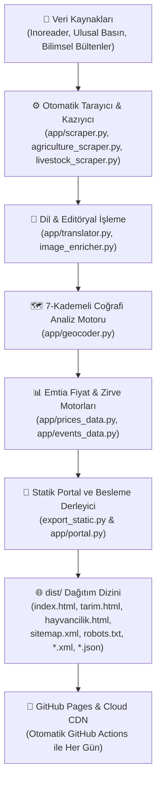

# 🌊 Su, Tarım & Hayvancılık Dijital Gazete Portalı
### *Water, Agriculture & Livestock Digital Newspaper & GIS Intelligence Portal*

[](https://mserman90.github.io/suhaber/)
[](https://github.com/mserman90/suhaber/actions)
[](https://opensource.org/licenses/MIT)
[](https://python.org)
[](https://leafletjs.com/)
[](https://mserman90.github.io/suhaber/)
[](https://mserman90.github.io/suhaber/)

---

## 🌍 Canlı Yayın ve Portallar (Live Portals)

Aşağıdaki bağlantılardan yayındaki canlı dijital gazete portallarına doğrudan erişebilirsiniz:

| Kanal | Açıklama | Canlı Web Portalı | Standart RSS 2.0 Yayını |
|---|---|:---:|:---:|
| 💧 **Su Gündemi** | Türkiye ve Dünya Su Kaynakları, Sulama, Barajlar ve Hidroloji | [**Canlı Aç (index.html)**](https://mserman90.github.io/suhaber/index.html) | [🔗 `rss.xml`](https://mserman90.github.io/suhaber/rss.xml) |
| 🌾 **Tarım Gündemi** | Bitkisel Üretim, Tohumculuk, Gübre, Destekler ve Akıllı Tarım | [**Canlı Aç (tarim.html)**](https://mserman90.github.io/suhaber/tarim.html) | [🔗 `rss_tarim.xml`](https://mserman90.github.io/suhaber/rss_tarim.xml) |
| 🐄 **Hayvancılık Gündemi** | Büyükbaş & Küçükbaş Besicilik, Çiğ Süt, Yem ve Hayvan Sağlığı | [**Canlı Aç (hayvancilik.html)**](https://mserman90.github.io/suhaber/hayvancilik.html) | [🔗 `rss_hayvancilik.xml`](https://mserman90.github.io/suhaber/rss_hayvancilik.xml) |
| 🌐 **Su Anlaşmaları Portalı** | Küresel Sınıraşan Sular ve İkili Anlaşmalar Veritabanı | [**Canlı Aç (External)**](https://mserman90.github.io/water-agreements-portal/) | — |
| ⚖️ **Yasal & KVKK Portalı** | Yasal Sorumluluk Reddi, 6698 Sayılı KVKK ve Gizlilik Politikası | [**Canlı Aç (yasal.html)**](https://mserman90.github.io/suhaber/yasal.html) | — |

---

## 🌟 Öne Çıkan Temel Özellikler

### 1. 📰 Üç Tematik Gazete Kanalı (Three Curated Editorial Channels)
* **Su Gündemi:** Baraj doluluk oranları (DSİ, İSKİ, İZSU, ASKi), kuraklık analizleri, GAP yatırımları, yer altı suyu yönetimi ve su verimliliği seferberliği.
* **Tarım Gündemi:** Tahıllar, yağlı tohumlar, gübre ve mazot destekleri, TMO hububat alım politikaları, Çukurova, Konya Ovası ve Harran bölgesel üretim raporları.
* **Hayvancılık Gündemi:** Ulusal Süt Konseyi (USK) çiğ süt tavsiye fiyatları, Et ve Süt Kurumu (ESK) karkas et ve kombina alımları, karma yem maliyetleri, damızlık yetiştiriciliği ve aşı takvimleri.

### 2. 🗺️ 7 Kademeli Akıllı Konumlandırma & İnteraktif Leaflet GIS Atlası
Her haber akıllı bir coğrafi analiz süzgecinden geçirilir ve en az 7 değerlendirme aşamasıyla haritadaki gerçek noktasına yerleştirilir:
1. **İl Düzeyi:** 81 Türkiye vilayeti ve uluslararası başkentler.
2. **Nehir Havzaları:** Türkiye'nin 25 hidrolojik havzası (Fırat-Dicle, Kızılırmak, Yeşilırmak, Gediz, Büyük Menderes, Sakarya vb.).
3. **Baraj ve Göller:** 100'ü aşkın kritik baraj (Atatürk, Keban, Karakaya, Ilısu, Ömerli, Tahtalı vb.) ve göl koordinatları.
4. **İlçe & Zirai Üretim Merkezleri:** Bafra, Çarşamba, Söke, Harran, Ödemiş, Polatlı, Ceyhan, Menemen gibi ana üretim havzaları.
5. **Kurumsal Tesisler:** DSİ bölge müdürlükleri, ESK kombinaları, TMO siloları ve sulama birlikleri.
6. **Küresel Havzalar:** Colorado, Nil, Ren, Tuna, Mekong, Murray-Darling gibi uluslararası su havzaları.
7. **Bağlamsal Doğrulama & Düşme Koruması:** Sahte eşleşmeleri filtreleyen ve koordinat doğruluğunu garanti altına alan çift yönlü metin analizi.

### 3. 🌐 Uluslararası Zirveler & Kongreler Takvimi (Global Events Hub)
Tüm kanallarda uluslararası öneme sahip prestijli toplantı ve kongreleri gösteren özel bir sekme yer alır:
* **Su:** UN World Water Forum, World Water Week (Stockholm), IWA World Water Congress, COP Climate Summits.
* **Tarım:** FAO World Food Forum, Agritechnica, International Wheat Congress, Smart Farming Expo.
* **Hayvancılık:** EuroTier Hannover, IDF World Dairy Summit, World Meat Congress, VIV Worldwide.
* Doğrudan etkinlik resmi sayfasına yönlendiren başvuru linkleri, şehir/ülke bilgileri ve tematik kategori etiketleri.

### 4. 📊 Karşılaştırmalı Canlı Emtia & Fiyat Takip Paneli (TR vs Dünya)
Tarım ve hayvancılık gündemlerinde Türkiye ile uluslararası piyasaları (AB Euronext/DG AGRI, ABD CBOT/USDA, Dünya FOB paritesi) yan yana getiren canlı karşılaştırma modülü:
* **Tarımsal Emtia:** Ekmeklik Buğday, Makarnalık (Durum), Mısır, Ayçiçeği Tohumu, Pamuk (Lif), Arpa, Çeltik (Pirinç), Soya Fasulyesi, Gübre (DAP / Üre) ve Çiftçi Mazotu.
* **Hayvansal Ürün & Yem:** USK Çiğ Süt, ESK Dana Karkas (E/U yağsız), Kuzu Karkas, Süt Yemi (%19 Ham Protein), Besi Yemi (%14 HP), Kuru Yonca Otu, Mısır Silajı, Arpa Kırması, Gebe Damızlık Düve ve Sofra Yumurtası.
* Güncel döviz kurları (EUR/TRY, USD/TRY) üzerinden otomatik parite hesaplama, prim/indirim göstergeleri ve pazar analiz notları.

### 5. 📱 %100 Duyarlı ve Mobil Uyumlu Tasarım (Mobile Responsive)
* Tüm cihaz boyutlarında (320px akıllı telefonlardan 4K masaüstü ekranlara) kusursuz çalışan `clamp()` tabanlı akıcı tipografi ve esnek ızgara (`minmax(0, 1fr)`).
* Mobilde ekranın sağa/sola taşmasını önleyen sıfır yatay kaydırma garantisi (`overflow-x: hidden`).
* Mobil haritada buton çakışmalarını önleyen akıllı katman düzeni ve tam ekran harita kipi.
* Ekranın altında akan son dakika haber bandı (ticker).

### 6. 🌐 Canlı Türkçe / İngilizce Dil Seçeneği (TR / EN)
Kullanıcılar tek bir butona tıklayarak web portalındaki tüm başlıkları, özetleri, arayüz butonlarını ve veri panellerini anında Türkçe veya İngilizce olarak okuyabilir.

### 7. 🔍 Arama Motoru Optimizasyonu (Google SEO & Social Meta)
* **Google Rich Results:** `NewsMediaOrganization`, `WebSite` (SearchAction) ve `CollectionPage` Schema.org JSON-LD yapısal verileri.
* **Open Graph & Twitter Cards:** WhatsApp, LinkedIn, Twitter ve Facebook'ta 1200x630 piksel yüksek çözünürlüklü görsel önizlemeleri.
* **Keşif Dosyaları:** Otomatik üretilen `sitemap.xml` ve arama botlarına yol gösteren `robots.txt`.

---

### 8. ⚖️ Hukuki Şeffaflık, Yasal Sorumluluk Reddi & 6698 Sayılı KVKK Uyumluluğu
* **Yasal Sorumluluk Reddi (Disclaimer):** Portalda sunulan tarımsal ve hayvansal emtia fiyatlarının, borsa göstergelerinin ve haber analizlerinin yatırım tavsiyesi, portföy danışmanlığı veya ticari taahhüt taşımadığına dair 6362 sayılı Kanun uyumlu sarih yasal bildirim.
* **6698 Sayılı KVKK & Gizlilik Politikası:** Sitede kullanıcı hesabı, üyelik veya e-bülten bulunmadığından ziyaretçilerden sıfır kişisel veri toplama prensibi. Ticari veya davranışsal reklam çerezlerinin kesinlikle kullanılmadığı, yalnızca tema ve dil tercihleri için cihazınızda yerel depolama (`localStorage`) tutulduğu güvencesi.
* **Künye, Telif Hakları ve Atıf (5846 Sayılı FSEK):** Habercilikte kamuoyunun haber alma hürriyeti ve adil kullanım (fair use) prensibiyle orijinal yayıncılara eksiksiz atıf.
* **Erişim Kolaylığı:** Sayfa altbilgisinden tek tıkla açılan sekmeli Türkçe/İngilizce modal pencere (`#legalModal`) ve arama motorlarınca taranabilen müstakil [yasal.html](https://mserman90.github.io/suhaber/yasal.html) sayfası.

---

## 🛠️ Sistem Mimarisi & Çalışma Döngüsü



---

## 💻 Yerel Geliştirme ve Kurulum (Local Setup)

Projeyi kendi bilgisayarınızda yerel olarak çalıştırmak veya katkıda bulunmak için:

```bash
# 1. Depoyu klonlayın
git clone https://github.com/mserman90/suhaber.git
cd suhaber

# 2. Python sanal ortamını oluşturun ve aktifleştirin
python -m venv venv
# Windows:
.\venv\Scripts\activate
# Linux/macOS:
source venv/bin/activate

# 3. Bağımlılıkları yükleyin
pip install -r requirements.txt

# 4. Portalları, RSS akışlarını ve sitemap dosyalarını derleyin
python export_static.py

# 5. dist/ dizinini yerel web sunucusuyla başlatın
python -m http.server 8000 --directory dist
```

Tarayıcınızda `http://localhost:8000/` adresine giderek portala göz atabilirsiniz.

---

## 📂 Dizin Yapısı

```text
├── .github/workflows/
│   └── cron_and_deploy.yml       # Her gün çalışan otomatik GitHub Actions CI/CD
├── app/
│   ├── portal.py                 # Gazete HTML/CSS/JS üretici & SEO / Schema.org motoru
│   ├── geocoder.py               # 7-kademeli GIS konumlandırma algoritması
│   ├── prices_data.py            # Canlı emtia fiyatları & parite karşılaştırma motoru
│   ├── events_data.py            # Uluslararası zirveler & kongreler takvimi
│   ├── scraper.py                # Su gündemi veri çekici
│   ├── agriculture_scraper.py    # Tarım gündemi veri çekici
│   ├── livestock_scraper.py      # Hayvancılık gündemi veri çekici
│   ├── translator.py             # Türkçe & İngilizce çeviri ve sınıflandırma
│   └── feed.py                   # RSS 2.0, Atom 1.0 ve JSON Feed üreticileri
├── dist/                         # GitHub Pages'a dağıtılan statik site
│   ├── index.html                # Su Gündemi
│   ├── tarim.html                # Tarım Gündemi
│   ├── hayvancilik.html          # Hayvancılık Gündemi
│   ├── yasal.html                # Yasal Sorumluluk Reddi ve KVKK Beyanı
│   ├── sitemap.xml               # Google Arama Motoru Haritası
│   ├── robots.txt                # Arama Motoru Robot Yönergeleri
│   └── *.xml / *.json            # RSS, Atom ve JSON Feed dosyaları
├── export_static.py              # Tüm portalları ve akışları derleyen ana script
├── requirements.txt              # Python bağımlılıkları
└── README.md                     # GitHub proje tanıtım dokümantasyonu
```

---

## 📜 Lisans & İletişim

Bu proje [MIT Lisansı](LICENSE) altında açık kaynak olarak geliştirilmektedir.
Öneri, hata bildirimi veya katkı için lütfen GitHub Issues sekmesini kullanınız.

**Proje Sahibi:** [@mserman90](https://github.com/mserman90)  
**Canlı Portal:** [https://mserman90.github.io/suhaber/](https://mserman90.github.io/suhaber/)
